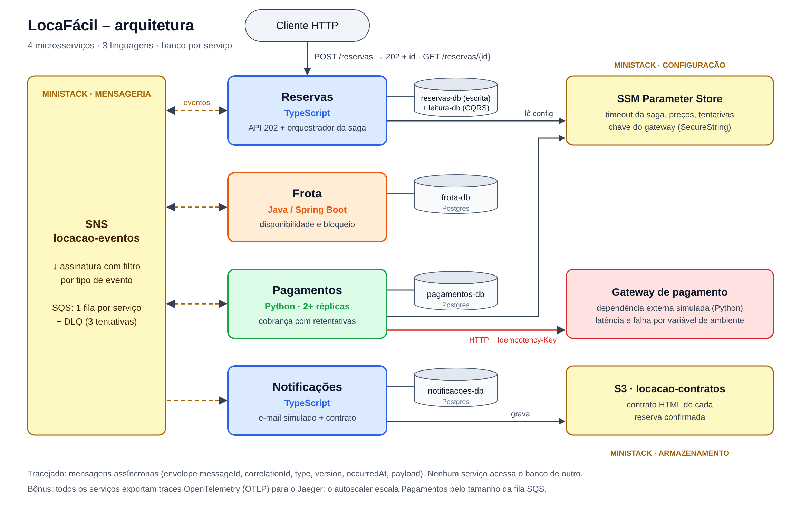

# LocaFácil – sistema distribuído de locação de veículos

Trabalho final de Sistemas Distribuídos (FURB). Um cliente pede a reserva de uma categoria de veículo numa
filial para um período. A reserva atravessa quatro microsserviços em três linguagens, com mensageria
assíncrona, compensação e uma dependência externa instável. Tudo roda localmente sobre o **MiniStack**
(emulador das APIs AWS).



| Serviço | Linguagem | Banco | Papel |
| --- | --- | --- | --- |
| `reservas` | TypeScript (Node 20, Express) | `reservas-db` (escrita) + `reservas-leitura-db` (leitura, CQRS) | API 202, orquestrador da saga, expiração |
| `frota` | Java 21 (Spring Boot 3) | `frota-db` | Disponibilidade e bloqueio do recurso escasso |
| `pagamentos` | Python 3.12 | `pagamentos-db` | Cobrança com retentativas e estorno, **2+ réplicas** |
| `notificacoes` | TypeScript (Node 20) | `notificacoes-db` | E-mail simulado e contrato no S3 |
| `gateway-pagamento` | Python (stdlib) | memória | Dependência externa simulada, lenta e instável |
| `jaeger` | — | memória | Coleta e exibe os traces OpenTelemetry (bônus) |
| `autoscaler` | Python | — | Escala `pagamentos` pelo tamanho da fila (bônus, perfil `autoscale`) |

## Como rodar

Pré-requisitos: Docker com Compose v2, `curl` e `jq` (para os scripts de demonstração).

```bash
docker compose up --build          # sobe MiniStack, cria a infra, 4 bancos e todos os serviços
./scripts/demo-fluxo-feliz.sh      # POST -> 202 -> status até CONFIRMADA -> contrato no S3
```

O contêiner `infra-init` roda `infra/init-ministack.sh` (AWS CLI) e cria tópico, filas, DLQs,
assinaturas, bucket e parâmetros. Nada é criado à mão. Para recriar do zero: `docker compose down -v && docker compose up --build`.

Portas: Reservas `3000`, Notificações `3001`, Frota `8081`, Gateway `8090`, MiniStack `4566`,
Jaeger `16686` (UI dos traces), Autoscaler `8091` (só com `--profile autoscale`).

```bash
curl -i -X POST localhost:3000/reservas -H 'Content-Type: application/json' \
  -d '{"clienteId":"cli-1","clienteEmail":"ana@example.com","filial":"BNU","categoria":"SUV","dataInicio":"2026-12-20","dataFim":"2026-12-22"}'
# HTTP/1.1 202 Accepted  Location: /reservas/<id>
curl localhost:3000/reservas/<id>          # status + histórico de transições (modelo de leitura)
curl localhost:3000/reservas/resumo        # contagem por status
curl "localhost:3000/reservas?clienteId=cli-1&status=CONFIRMADA"   # listagem (modelo de leitura)
curl "localhost:8081/ocupacao?filial=BNU&categoria=SUV"
curl localhost:8090/cobrancas              # o que o gateway cobrou
curl -X POST localhost:8090/config -d '{"taxa_falha":1.0}'   # muda a instabilidade ao vivo
```

## Fluxo principal (saga orquestrada pelo serviço Reservas)

```
POST /reservas ─► Reservas: PENDENTE ── ReservaSolicitada ─► Frota
                                                              │ bloqueia 1 unidade por dia do período
     ◄── VeiculoIndisponivel ── (sem vaga) → REJEITADA ───────┤
     ◄── VeiculoBloqueado ────────────────────────────────────┘
Reservas: AGUARDANDO_PAGAMENTO ── PagamentoSolicitado ─► Pagamentos ─► gateway instável (retentativas)
     ◄── PagamentoAprovado  → CONFIRMADA ── ReservaConfirmada ─► Frota (efetiva) + Notificações (e-mail + S3)
     ◄── PagamentoRecusado  → CANCELADA  ── ReservaCancelada  ─► Frota (COMPENSA: libera) + Notificações
     timeout sem resposta   → EXPIRADA   ── ReservaCancelada  ─► idem
     PagamentoAprovado depois de EXPIRADA ── EstornoSolicitado ─► Pagamentos ── PagamentoEstornado ─► Notificações
```

Os três elementos exigidos no registro:

1. **Transação distribuída com compensação**: Reservas → Frota → Pagamentos; falha desfaz o bloqueio na Frota e estorna pagamento tardio.
2. **Dependência lenta/instável**: `gateway-pagamento`, com latência e falha por variável de ambiente.
3. **Evento com vários interessados**: `ReservaConfirmada` e `ReservaCancelada` (Frota e Notificações).

## Onde cada requisito está no código

| # | Requisito | Onde |
| --- | --- | --- |
| R1 | At-least-once com idempotência | Tabela `mensagens_processadas` em todo serviço. O `INSERT ... ON CONFLICT DO NOTHING` do `messageId` roda **na mesma transação** do efeito: `services/reservas/src/infra.ts` (`handleMessage`), `services/frota/.../MessageConsumer.java` (`handle`), `services/pagamentos/app/main.py` (`handle`). Duplicata = 0 linhas inseridas = efeito ignorado. |
| R2 | Zero venda dupla | `FrotaService.reservaSolicitada`: `UPDATE ocupacao SET reservados = reservados + 1 WHERE ... AND reservados < capacidade`, dia a dia em ordem crescente, com savepoint. Além disso a `CHECK (reservados <= capacidade)` em `schema.sql` impede overbooking no próprio banco. |
| R3 | API assíncrona | `POST /reservas` grava reserva + evento (outbox) e responde `202` com `reservaId` e `Location`; `GET /reservas/:id` dá o status. Aceita `Idempotency-Key`. |
| R4 | Consumidores concorrentes | `pagamentos` sobe com `deploy.replicas: 2` na mesma fila; a Frota também usa 4 threads consumidoras. Cada pagamento grava `processado_por` (hostname da réplica). |
| R5 | Dependência instável | `GATEWAY_LATENCIA_MS`, `GATEWAY_JITTER_MS`, `GATEWAY_TAXA_FALHA`, `GATEWAY_TAXA_RECUSA` (`docker-compose.yml`, `services/gateway-pagamento/gateway.py`). |
| R6 | Reconexão | Laços de consumo e relay nunca terminam com erro de broker: backoff exponencial até 15 s e continuam (`startConsumer`, `consumer_loop`, `MessageConsumer.loop`). A API continua aceitando pedidos com o broker fora porque grava na **outbox**, drenada depois. |

Outras regras do enunciado:

- **Contratos**: `contracts/envelope.schema.json` (envelope único: `messageId`, `correlationId`, `type`, `version`, `occurredAt`, `payload`), `contracts/events/*.schema.json` (um JSON Schema por evento/versão) e `contracts/asyncapi.yaml`.
- **Banco por serviço**: quatro contêineres Postgres; nenhum serviço conhece a URL do banco de outro.
- **Configuração por ambiente**: endpoint, região, credenciais, nomes de tópico e fila vêm de variáveis de ambiente. Os serviços resolvem ARN/URL pelo nome; sem `AWS_ENDPOINT_URL` o mesmo código fala com a AWS real.
- **Health check**: `GET /health` em todos (inclui itens pendentes na outbox e último erro de broker).
- **Mensagem venenosa**: payload inválido gera `PoisonMessage`; a mensagem não é apagada, volta em 2 s e, após `maxReceiveCount=3`, o SQS a move para `<serviço>-dlq`.

## Serviços de nuvem e justificativas

| Categoria | Escolha | Por que, e não a alternativa |
| --- | --- | --- |
| Mensageria | **SNS + SQS** (tópico único com filas filtradas por `type`) | SNS faz o fan-out (um evento, vários interessados) e SQS dá at-least-once, visibility timeout, consumidores concorrentes e DLQ nativa. EventBridge seria exagero para um único barramento. RabbitMQ/Kafka exigiriam operar o broker, e Kafka traria ordenação por partição de que a saga não precisa. |
| Armazenamento de objetos | **S3** | O contrato é um documento imutável e grande; guardá-lo no banco inflaria o Postgres. A chave determinística (`contratos/<reservaId>.html`) torna a gravação idempotente. |
| Segredos e configuração | **SSM Parameter Store** | Centraliza o timeout da saga, os preços, as tentativas e a chave do gateway (`SecureString`). O Reservas relê a cada 10 s, então o timeout muda sem redeploy (usado no F7). É mais simples e barato que o Secrets Manager quando não há rotação automática. |
| Banco | Postgres em contêiner, um por serviço (equivale ao RDS na AWS) | A transação ACID local é o que garante a idempotência (inbox) e a outbox no mesmo commit, e o `UPDATE` condicional resolve a concorrência. No DynamoDB isso exigiria transações e condições mais complexas. |

## Cenários de falha (scripts em `scripts/`)

Cada script provoca a falha, espera e mostra logs e o estado dos bancos.

| # | Script | O que mostra |
| --- | --- | --- |
| F1 | `f1-compensacao.sh` | Gateway com 100% de falha: 3 tentativas, `PagamentoRecusado(GATEWAY_INDISPONIVEL)`, reserva `CANCELADA`, bloqueio `LIBERADO`, ocupação volta, notificação de cancelamento. |
| F2 | `f2-servico-morre.sh` | `docker kill` na réplica que está cobrando. A transação não comitou; a mensagem volta após 60 s para a outra réplica; o gateway devolve o mesmo resultado (Idempotency-Key = reservaId). Uma cobrança e um pagamento. |
| F3 | `f3-duplicada.sh` | A mesma `ReservaSolicitada` (mesmo `messageId`) republicada 5×: Frota registra "mensagem duplicada ignorada", e a ocupação não muda. |
| F4 | `f4-venenosa.sh` | JSON inválido e payload fora do schema: 3 tentativas e depois a `frota-dlq`; uma reserva normal publicada em seguida termina normalmente. |
| F5 | `f5-corrida.sh` | 100 `POST` simultâneos para 10 SUVs no mesmo dia: 10 `CONFIRMADA` e 90 `REJEITADA`, com `reservados = 10`. |
| F6 | `f6-broker-fora.sh` | `docker compose pause ministack` por 30 s. A API segue aceitando (outbox cresce), os consumidores logam "reconectando", e depois do `unpause` tudo drena sem reiniciar nenhum serviço. |
| F7 | `f7-resposta-tardia.sh` | Timeout da reserva 5 s (SSM) e gateway 9 s: reserva `EXPIRADA` e veículo liberado; o pagamento aprovado depois gera `EstornoSolicitado`, o pagamento fica `ESTORNADO` e o cliente é notificado. |
| F8 | `f8-escala.sh` | `--scale pagamentos=3`: a contagem por `processado_por` mostra a carga dividida, sem pagamento ou mensagem duplicados. |

Falha surpresa (ex.: derrubar a Frota): as mensagens ficam na `frota-queue`, e as reservas ficam `PENDENTE`
(a API continua respondendo 202). Quando a Frota volta, consome o acumulado e a saga continua. Reservas já em
`AGUARDANDO_PAGAMENTO` seguem normalmente, porque não dependem da Frota até a confirmação.

> **F6 com MiniStack**: o MiniStack guarda filas e mensagens em memória. Um `stop` apagaria tudo (e isso não
> aconteceria com um broker real), por isso o script usa `pause`, que deixa o broker inacessível sem perder o estado.

## Ordenação (discussão para R4)

As filas SQS são *standard*: não há garantia de ordem e pode haver duplicata. O sistema não depende de ordem:

- **Reservas** é uma máquina de estados: cada handler trava a linha (`SELECT ... FOR UPDATE`) e só age se o
  estado atual permite a transição. Um evento fora de ordem é ignorado com log (ex.: `VeiculoBloqueado` para reserva já rejeitada).
- **Frota**: se `ReservaCancelada` chegar antes da `ReservaSolicitada`, grava uma "lápide" `LIBERADO`; a solicitação atrasada vê que já existe registro e não bloqueia.
- **Pagamento tardio** depois da expiração não é erro: vira estorno (F7).
- Se fosse preciso ordem estrita por reserva, a alternativa seria SQS FIFO com `MessageGroupId = reservaId`,
  o que custa vazão (um grupo é processado em série) e não elimina a necessidade de idempotência.

## Bônus implementados

Os cinco itens de bônus do enunciado estão implementados:

- **Versionamento de eventos**: `ReservaConfirmada` v1 (`valorTotal: number`) e v2 (`valor: {total, moeda}`, `transacaoId`).
  O Reservas publica a versão de `RESERVA_CONFIRMADA_VERSAO` (padrão 2). A Frota é leitor tolerante (só usa `reservaId`),
  e Notificações tem um *upcaster* v1→v2. Para demonstrar: `RESERVA_CONFIRMADA_VERSAO=1 docker compose up -d reservas`, crie
  uma reserva e confira `versao_evento` em `GET :3001/notificacoes`.
- **Infraestrutura como código**: `infra/terraform/main.tf` recria tópico, filas, DLQs, assinaturas, bucket e parâmetros
  (`terraform init && terraform apply` com o MiniStack no ar).
- **Tracing distribuído (OpenTelemetry)**: os quatro serviços exportam spans via OTLP para o Jaeger
  (<http://localhost:16686>). O envelope não muda: o contexto W3C (`traceparent`) é capturado quando o evento
  entra na **outbox** (coluna `outbox.traceparent`) e viaja como *atributo da mensagem* SNS/SQS
  (`RawMessageDelivery`). Cada publicação é um span `PRODUCER` (`<Evento> publish`) e cada consumo um span
  `CONSUMER` (`<Evento> process`) filho dele, nas três linguagens:
  `services/*/src/infra.ts` + `tracing.ts` (TypeScript), `Tracing.java`/`OutboxRelay.java`/`MessageConsumer.java` (Java),
  `services/pagamentos/app/main.py` (Python, com um span por tentativa no gateway). A expiração da saga retoma o
  trace do `POST` (coluna `reservas.traceparent`), então até a compensação do F7 aparece na mesma linha do tempo.
  Para demonstrar: rode `./scripts/demo-fluxo-feliz.sh`, abra o Jaeger, serviço `reservas`, operação `POST /reservas`:
  um único trace passa por Reservas → Frota → Reservas → Pagamentos (gateway) → Reservas → **Frota e Notificações**
  (fan-out do `ReservaConfirmada`, com o `S3 PutObject contrato`). Desligar: `OTEL_SDK_DISABLED=true`.
- **Modelo de leitura separado (CQRS)**: o Reservas escreve em `reservas-db` (tabelas normalizadas, locks, máquina de
  estados) e **todas as consultas** (`GET /reservas`, `/reservas/:id`, `/reservas/resumo`) leem só o banco
  `reservas-leitura-db`, numa tabela desnormalizada `reservas_view` com o histórico embutido em JSON. Cada mudança grava
  `projecao_pendente` **na mesma transação** (nenhuma alteração escapa); o projetor copia o *estado atual* (não aplica
  deltas), então reprocessar é idempotente e a ordem não importa, e um `WHERE atualizado_em <=` impede que uma cópia
  velha sobrescreva uma nova. A consistência é eventual (milissegundos): logo depois do `202`, o `GET` pode dar 404
  por um instante. `/health` mostra `modeloLeitura.pendentes`. Código: `startProjetor` em `services/reservas/src/index.ts`.
- **Autoescala do consumidor pela fila**: `services/autoscaler` lê `ApproximateNumberOfMessages(+NotVisible)` da
  `pagamentos-queue` a cada 5 s e ajusta as réplicas de `pagamentos` para `ceil(profundidade / 5)`, entre 2 e 6
  (`AUTOSCALE_MIN`, `AUTOSCALE_MAX`, `AUTOSCALE_MSGS_POR_REPLICA`). Sobe na hora; desce uma réplica por vez após 30 s
  de fila baixa (evita oscilação). Escala via `docker compose up --scale` pelo socket do Docker; na AWS o equivalente
  seria Application Auto Scaling do ECS com alarme do CloudWatch na mesma métrica. Reduzir é seguro: o `pagamentos`
  trata `SIGTERM` (termina a mensagem atual, devolve à fila as que não começou) e tudo é idempotente.
  Fica num *profile* para não interferir no F8 manual:
  `docker compose --profile autoscale up -d autoscaler` ou `./scripts/bonus-autoescala.sh`
  (40 reservas com gateway lento: 2 → 6 réplicas, todas confirmadas, sem pagamento duplicado, e volta gradual a 2).

## Estrutura

```
contracts/            envelope + JSON Schemas por evento/versão + AsyncAPI + exemplos
docs/arquitetura.svg  diagrama (PNG também)
infra/                init-ministack.sh (usado pelo compose) e terraform/
scripts/              demo-fluxo-feliz.sh, f1..f8 e bonus-autoescala.sh
services/reservas     TypeScript   services/notificacoes  TypeScript
services/frota        Java/Spring  services/pagamentos    Python
services/gateway-pagamento  Python   services/autoscaler  Python (bônus)
```

## Variáveis úteis

| Variável | Padrão | Efeito |
| --- | --- | --- |
| `GATEWAY_LATENCIA_MS` / `GATEWAY_JITTER_MS` | 800 / 700 | Latência do gateway |
| `GATEWAY_TAXA_FALHA` / `GATEWAY_TAXA_RECUSA` | 0.2 / 0.05 | Falha técnica (503) / recusa de negócio (402) |
| `GATEWAY_TIMEOUT_SEGUNDOS` | 10 | Timeout do cliente HTTP em Pagamentos |
| `PAGAMENTOS_REPLICAS` | 2 | Réplicas do consumidor de pagamentos |
| `RESERVA_TIMEOUT_SEGUNDOS` | 30 | Valor inicial do parâmetro SSM de timeout da saga |
| `MAX_RECEIVE_COUNT` | 3 | Tentativas antes da DLQ |
| `RESERVA_CONFIRMADA_VERSAO` | 2 | Versão de `ReservaConfirmada` publicada |
| `OTEL_SDK_DISABLED` | false | `true` desliga o tracing |
| `OTEL_EXPORTER_OTLP_ENDPOINT` | `http://jaeger:4318` | Coletor OTLP (Jaeger local ou outro) |
| `AUTOSCALE_MIN` / `AUTOSCALE_MAX` | 2 / 6 | Limites do autoscaler |
| `AUTOSCALE_MSGS_POR_REPLICA` / `AUTOSCALE_ESFRIAMENTO` | 5 / 30 | Mensagens por réplica / segundos antes de reduzir |
